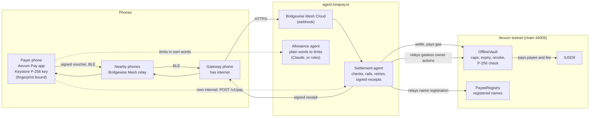

# Bridgewise Aevum Pay

Stablecoin payments with tUSD8 that go through when the payer has no signal.
Built for the Aevum Builder Challenge #1 on QDay Aevum testnet (chain 44005).

The payer's phone signs a payment voucher offline with a key held in Android Keystore.
The voucher travels over Bridgewise Mesh (Bluetooth, phone to phone) until a phone with
internet uploads it. A settlement agent submits it to the `OfflineVault` contract, pays the
gas, and sends a receipt back over the mesh.

This repo holds the contracts (`src/`) with their tests and scripts, the settlement agent
(`agent/`, live at https://agent.lorapay.io), and the Android wallet app (`app/`).

## Architecture



Core workflows, each with its code:

| Workflow | What happens | Code |
|---|---|---|
| First run | Wallet, starter money, gasless deposit, phone key with limits, PIN | `app/src/payments/engine.ts` `setUpWallet` |
| Pay offline | Voucher signed after the fingerprint, carried by the mesh, settled, receipt checked | `engine.ts` `confirmAndPay`, `deliver`; `agent/src/settler.ts` |
| Pay online | The same voucher sent straight to the agent | `POST /v1/pay` in `agent/src/publicRoutes.ts` |
| Confirmation of Payee | Name registered on chain, looked up before paying, kept for offline | `src/PayeeRegistry.sol`, `/v1/names` |
| Allowance agent | "$10 a day this week" becomes limits the person approves | `agent/src/allowance.ts`, `app/src/screens/LimitsScreen.tsx` |
| Money in | The payee sees who paid them | `GET /v1/payments/to/:address` |
| Revoke and withdraw | Turn the phone off, move money back | `revokeBySig`, `withdrawBySig` |

## Network

| | |
|---|---|
| Network | QDay Aevum Testnet |
| Chain ID | 44005 |
| RPC | https://rpc-test.qday.info |
| Explorer | https://explorer-test.qday.info |
| Faucet | https://faucet.qday.info/en |
| Gas token | tQDAY |
| tUSD8 | `0x456569838f1d43009A91ebA4263147Afd7233483` (ERC-20, 6 decimals) |
| EVM version | Shanghai |

## How it works

```
 payer phone (offline)        relay phones          gateway phone        settlement agent         Aevum testnet
 ┌──────────────────┐  BLE  ┌──────────────┐  BLE  ┌─────────────┐ HTTPS ┌────────────────┐  tx   ┌──────────────┐
 │ Keystore P-256   │ ────▶ │ carry sealed │ ────▶ │ uploads     │ ────▶ │ checks, pays   │ ────▶ │ OfflineVault │
 │ signs voucher    │       │ voucher      │       │             │       │ gas, settles   │       │ pays payee   │
 │                  │ ◀──── │              │ ◀──── │             │ ◀──── │ signed receipt │ ◀──── │ and fee      │
 └──────────────────┘       └──────────────┘       └─────────────┘       └────────────────┘       └──────────────┘
```

1. **Deposit.** The owner moves tUSD8 into the vault (`deposit`, or `depositWithPermit` relayed by the agent).
2. **Open a session.** The phone creates a P-256 key in Android Keystore. The owner registers its public
   key with a per payment cap, a daily cap and an expiry (`openSession` or `openSessionBySig`).
3. **Pay offline.** The phone signs a `Voucher` (payee, amount, max fee, random nonce, valid before).
4. **Settle.** Anyone online can call `settle`. The vault checks the signature, the caps, the expiry and the
   nonce, pays the payee, and pays the submitter a fee no larger than the signed `maxFee`.
5. **Revoke.** The owner can revoke a session at any time (`revokeSession` or `revokeBySig` from another device),
   and withdraw what is left.

The owner never needs tQDAY: every owner action has a signed version the agent can relay, and the agent
pays gas in exchange for the fee in tUSD8.

## Safety controls

| Control | Where |
|---|---|
| Key never leaves hardware | Session key is an Android Keystore P-256 key, checked on chain with OpenZeppelin `P256` |
| Least privilege | A session key can only spend from its owner's vault balance, nothing else |
| Budget caps | Per payment cap and daily cap, enforced on chain |
| Expiry | Session expiry and per voucher `validBefore` |
| Revocation | `revokeSession`, or `revokeBySig` relayed from any device |
| Replay protection | Random 32 byte nonce per voucher, stored once used |
| Tamper protection | Payee, amount, fee and expiry are all signed; relays cannot change them |
| Fee limit | The settler cannot take more than the `maxFee` the payer signed |
| Audit trail | `Deposited`, `SessionOpened`, `SessionRevoked`, `VoucherSettled`, `Withdrawn` events |
| The person, not just the phone | The Keystore key signs only after the phone's fingerprint or screen lock (30 s window); app PIN and auto lock |
| Confirmation of Payee | `PayeeRegistry`: one name per wallet, one wallet per name, case blind, no look alike characters; the app warns when a code's name differs from the registered one, and can refuse unregistered payees |
| Agent rails | Minimum fee, longest validity, rate limits per key, per node and per IP, daily transaction and gas budgets |
| Agent proposals only | The allowance agent proposes limits; the person approves them with the fingerprint; the vault enforces them; ceilings of $50 a payment, $200 a day, 30 days |

## Agents

Live at **https://agent.lorapay.io/activity**: every vault event on Aevum testnet, read from the chain.
https://agent.lorapay.io/health shows the commit that is deployed (`commit`).

`agent/` is a small TypeScript service (viem, Hono, SQLite) with two agents:

- **Settlement agent.** Receives vouchers from the Mesh Cloud webhook (or straight from a phone with
  internet), simulates them, settles them with retries that can never pay twice, pays the gas, earns
  the fee, and answers with a receipt it signs (EIP-712). It also relays the owner's gasless actions
  and name registrations, and gives new wallets starter test money.
- **Allowance agent.** Turns "let me spend up to $10 offline this weekend, nothing over $3 at once"
  into offline limits. It uses Claude when an Anthropic key is set, and simple rules otherwise. It
  can only propose: the person approves with their fingerprint, and the vault enforces the limits.

See [agent/README.md](agent/README.md).

## Android app

`app/` is the phone wallet (React Native 0.87.1), written for people who have never used crypto:
dollars and plain words, one tap setup with starter test money, scan to pay, contacts, a PIN, and
a fingerprint for every payment. Underneath, it moves tUSD8 into the vault with a permit, gives the
phone its own Keystore key with limits (bound to the person's fingerprint or screen lock), signs
payments offline, and sends them over Bridgewise Mesh. A receipt only counts if the agent signed
it. See [app/README.md](app/README.md).

## Voucher signing format

```
Voucher(bytes32 sessionId,address payee,uint256 amount,uint256 maxFee,bytes32 nonce,uint64 validBefore)
EIP-712 domain: name "Bridgewise OfflineVault", version "1", chainId 44005, verifyingContract = vault
```

The phone computes the EIP-712 digest and signs it with `SHA256withECDSA` in Android Keystore.
Keystore hashes its input, so the contract verifies the P-256 signature over `sha256(digest)`
(`voucherSigningHash`). Convert the DER signature from Keystore to raw `r` and `s`. High S values are accepted.

## Run it

Needs [Foundry](https://getfoundry.sh). On Windows, use Git Bash.

```bash
git clone --recursive https://github.com/<you>/bridgewise-aevum-pay
cd bridgewise-aevum-pay
forge test
```

Deploy and try it on Aevum testnet:

```bash
cast wallet import aevum-payer --interactive          # once
export PAYER=0xYourAddress PAYEE=0xPayeeAddress

forge script script/SendTUSD8.s.sol    --rpc-url aevum --account aevum-payer --broadcast
forge script script/DeployVault.s.sol  --rpc-url aevum --account aevum-payer --broadcast

export VAULT=0xDeployedVault
export SESSION_P256_KEY=0x$(openssl rand -hex 32)    # test key standing in for the phone
forge script script/DemoOfflinePayment.s.sol --rpc-url aevum --account aevum-payer --sender $PAYER --broadcast

# Confirmation of Payee
forge script script/DeployRegistry.s.sol --rpc-url aevum --account aevum-payer --broadcast
```

## Contract addresses (Aevum testnet)

| Contract | Address |
|---|---|
| OfflineVault | [`0x5E6f3d12AaeB6732840432D19BCc26a35e0F0184`](https://explorer-test.qday.info/address/0x5E6f3d12AaeB6732840432D19BCc26a35e0F0184) |
| PayeeRegistry | [`0xE1d0b5A22B35Cf03854C7DB311Dce95c6a4Cb45F`](https://explorer-test.qday.info/address/0xE1d0b5A22B35Cf03854C7DB311Dce95c6a4Cb45F) (block 3907155, 23 Nov 2026) |
| tUSD8 | [`0x456569838f1d43009A91ebA4263147Afd7233483`](https://explorer-test.qday.info/address/0x456569838f1d43009A91ebA4263147Afd7233483) |

### On chain proof (20 Nov 2026)

| Step | Transaction |
|---|---|
| First tUSD8 transfer from a script | [`0x64d7...e3e8`](https://explorer-test.qday.info/tx/0x64d797238d04e5381d9c6b4eebc2e620f5fd8e575a552bdb091d289f40d1e3e8) |
| Deploy OfflineVault | [`0xba63...2b53`](https://explorer-test.qday.info/tx/0xba6351e01859e8cd31a3eb376e641dbfbcfb25e3b3192b61673850f41b632b53) |
| Approve vault | [`0x19e0...b523`](https://explorer-test.qday.info/tx/0x19e036e6755adeb23e8ba9db2d814474d8664eb86327bbf3e8495c895763b523) |
| Deposit 3 tUSD8 | [`0xb7f1...48e3`](https://explorer-test.qday.info/tx/0xb7f1c3a6fe517c85fc9c02530870cef1c82b0472a60a123be2031dd6d8f848e3) |
| Open session for a P-256 key | [`0xa889...637b`](https://explorer-test.qday.info/tx/0xa88911218e3029f6c5ddc29218f538ff464110d7ac2c6a983642b9ec07af637b) |
| Settle a P-256 signed voucher (1 tUSD8, fee 0.01) | [`0x1a29...ec6c`](https://explorer-test.qday.info/tx/0x1a29140abbd17f5dcc26bdcbd8eafa4a99171dfa2132714cf1344a89e679ec6c) |

## Known limits

1. **Spending across merchants while offline.** Two merchants can each accept a voucher before either is
   settled. If both together exceed the vault balance, the later one fails. Caps bound the loss, and payees
   see "pending" until settlement.
2. **Daily cap counts by settlement day,** not by the day the voucher was signed, because the phone's clock
   cannot be trusted.
3. **Permissionless settlement.** Anyone holding a voucher may settle it and take the fee (up to `maxFee`).
   The payee is always paid the signed amount.
4. **Gas.** The P-256 check runs in Solidity (about 376k gas per settlement on Aevum) because Aevum has no
   P-256 precompile yet. At the testnet gas price seen on 20 Nov (8 wei) that is negligible. The contract uses
   the RIP-7212 precompile automatically if one appears.
5. **Registered names are first come, first served.** The registry proves which wallet holds a name, not
   who someone is in the world, so the app says "registered name", never "verified identity".
6. **The Bridgewise Mesh SDK is not part of this repository.** The app needs it next to this
   repository (`../../mesh-sdk`) to build.

## License

MIT. Third party code and licences: [NOTICE.md](NOTICE.md).
